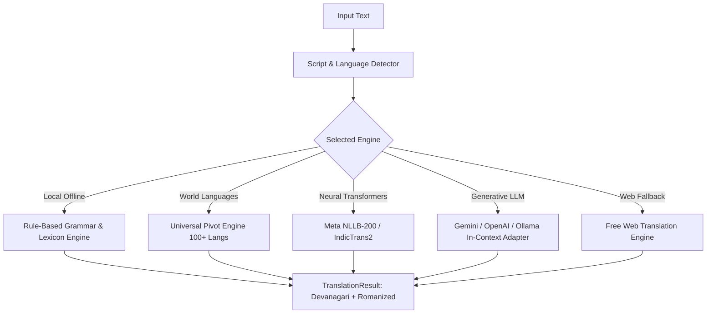

# Bodo Language Library (`bodo_language_library`) — Technical & Linguistic Documentation

---

## 1. Introduction & Linguistic Foundations

The **Bodo Language** (*बड़ो / बर'*, ISO 639-3: `brx`, FLORES-200 / NLLB: `brx_Deva`) belongs to the Bodo-Garo branch of the Tibeto-Burman language family. Recognized under the Eighth Schedule of the Indian Constitution, it is an official language of the Bodoland Territorial Region (BTR) and an associate official language of the state of Assam, India.

### 1.1 Script & Orthography
- **Devanagari Script (*बर' हांखो*)**: Officially adopted in 1974 following decades of linguistic mobilization by the Bodo Sahitya Sabha (*बर' थुनलाइ आफाद*).
- **Romanized / Latin Script**: Extensively used in digital communication, online messaging, and historical literature.
- **High-Tone Marker**: Written Bodo frequently employs the apostrophe (`'`) or acute accent to represent high-pitch vowels and glottal tone contrasts (e.g., `बर'`, `गथ'`, `न'`).

### 1.2 Phonology & Tone System
Bodo features a prominent **two-tone phonological pitch contrast**:
1. **High Pitch (High Tone)**: Characterized by an elevated fundamental frequency ($F_0$) often accompanied by glottal constriction or abrupt release.
2. **Low Pitch (Standard Tone)**: A level or falling tone trajectory characterizing unmarked lexical roots.

### 1.3 Agglutinative Morphology & Word Order
Bodo is an **agglutinative language** with strict **Subject-Object-Verb (SOV)** canonical sentence structure. Grammatical relations, case markers, pluralization, and temporal aspect cliticize sequentially to root morphemes without mutating the underlying lexical stem.

---

## 2. Architecture & Package Structure

```
e:\AI\bodo\
├── pyproject.toml               # Modern PEP 517/621 packaging for PyPI
├── setup.py                     # Setuptools compatibility script
├── README.md                    # Overview, badges, and quick start
├── DOCUMENTATION.md             # Comprehensive linguistic & API reference
├── LICENSE                      # MIT License
├── .gitignore                   # Version control exclusions
│
├── bodo_language_library/       # Primary package (import bodo_language_library)
├── bodonlp/                     # Core library package (import bodonlp)
│   ├── __init__.py              # Unified library API, facade, and exports
│   ├── constants.py             # ISO codes (brx), scripts, POS, tenses, classifiers, kinship, seasons, calendar
│   ├── phonetics.py             # Bodo phonetics: Devanagari <-> Latin transliteration, tones, tokenization, syllabification
│   │
│   ├── numbers/                 # Bodo numeral system
│   │   ├── __init__.py          # num_to_words, words_to_num, ordinals, fractions
│   │   └── classifiers.py       # Bodo numeral classifiers (सा-, मा-, गं-, दं-, थाइ-, etc.)
│   │
│   ├── grammar/                 # Bodo grammar and morphology
│   │   ├── __init__.py          # Verb conjugation, noun declension, pronouns, case markers
│   │   ├── verb.py              # Bodo verb conjugation (tenses, aspect, negation, imperative)
│   │   ├── noun.py              # Pluralization (-फोर), case markers (-खौ, -जों, -नो, -निफ्राय, -नि, -आव)
│   │   ├── pronouns.py          # Pronoun paradigm (1st, 2nd, 3rd person, honorifics)
│   │   └── syntax.py            # SOV sentence builder, echo words, interrogatives
│   │
│   ├── lexicon/                 # Lexicon & Dictionary engine
│   │   ├── __init__.py          # Word, Lexicon, lookup, search, lemmatize
│   │   ├── dictionary.py        # High-performance search across Bodo Devanagari, Roman Bodo, English, and Hindi
│   │   └── data/                # Bundled offline datasets
│   │       ├── words.json       # Cleaned, structured dictionary of 36,800+ entries
│   │       ├── phrases.json     # Essential everyday phrases & conversational pairs
│   │       ├── proverbs.json    # Traditional proverbs with translations & explanations
│   │       └── riddles.json     # Traditional riddles with clues and answers
│   │
│   ├── translator/              # Multi-Engine Universal Translation System
│   │   ├── __init__.py          # Translator, TranslationResult, translate()
│   │   ├── engine.py            # Unified translation coordinator (Bodo <-> any world language)
│   │   ├── rule_based.py        # High-speed offline bidirectional translator (Bodo <-> English, Bodo <-> Hindi)
│   │   ├── pivot.py             # Universal pivot translator connecting Bodo to 100+ global languages
│   │   ├── hf_adapter.py        # HuggingFace NLLB-200 (brx_Deva) & IndicTrans2 models adapter
│   │   ├── llm_adapter.py       # LLM translation adapter (OpenAI / Gemini / Ollama / Anthropic)
│   │   └── web_adapter.py       # Free web translation fallback
│   │
│   ├── culture/                 # Bodo Cultural Heritage & Knowledge Engine
│   │   ├── __init__.py          # Cultural treasures, festivals, calendar, heritage
│   │   └── (festivals, instruments, attire, Bathou tradition, clans, calendar)
│   │
│   ├── scraper/                 # Web Scrapers & Internet Ingestion Engine
│   │   ├── __init__.py          # Scraper classes & document mining tools
│   │   ├── wiki_scraper.py      # Bodo Wikipedia / Wikimedia Incubator API scraper
│   │   ├── glosbe_scraper.py    # Glosbe dictionary & bilingual sentence pair scraper
│   │   └── corpus_collector.py  # HuggingFace & web document corpus miner
│   │
│   ├── voice/                   # Voice & Speech Synthesis Helper
│   │   ├── __init__.py          # VoiceTranslator, SSML generator, phonetic cadence, tones
│   │   └── cadence.py           # Syllable stress, tone markers (high/low pitch tone in Bodo)
│   │
│   └── cli.py                   # Full-featured command line interface
│
├── data_sources/                # Ingestion, scraping scripts, and data enrichment tools
│   ├── README.md                # Documentation on data sources, scraping, and verification
│   ├── scrape_wiki_bodo.py      # Ready-to-run script to scrape Bodo Wikipedia articles
│   ├── scrape_glosbe.py         # Glosbe scraper script
│   ├── fetch_huggingface_corpus.py # Script to pull FLORES-200 & IndicCorp Bodo splits
│   └── ingest_dictionary.py     # Bihung data ingestion pipeline
│
└── tests/                       # Comprehensive test suite (37 tests)
```

---

## 3. Lexicon & Multi-Way Dictionary Engine

The library bundles **36,802 dictionary entries** parsed from official publications of the Bodo Sahitya Sabha (*Bihung*), indexed for $O(1)$ constant-time lookup.

### 3.1 Data Schema
Each vocabulary entry is structured as a `Word` dataclass:
```python
@dataclass
class Word:
    bodo: str       # Devanagari headword (e.g., 'अंखा')
    roman: str      # Phonetic Romanization (e.g., 'ongkha')
    english: str    # English definition/gloss (e.g., 'midge, sand-fly')
    hindi: str      # Hindi equivalent where available
    pos: str        # Part of speech ('noun', 'verb', 'adjective', etc.)
    category: str   # Domain ('general', 'archeology', 'geology', 'technology', etc.)
```

### 3.2 Lookup & Fuzzy Search
```python
import bodonlp

# Exact Match across Bodo, Romanized, or English
w = bodonlp.lookup("बिफां")
print(w.english)  # tree, plant

# Inverted English Index & Synonym Fallbacks
w_en = bodonlp.lookup("teacher")
print(w_en.bodo)  # फोरोंगिरि

# Fuzzy & Substring Search
matches = bodonlp.search("dance", limit=3)
for m in matches:
    print(m.bodo, m.english)
```

---

## 4. Numeral System & Classifiers

A hallmark of Bodo grammar is that cardinal numerals never qualify nouns directly without a **numeral classifier**. The library includes an automatic classifier resolution engine:

| Classifier | Roman | Category / Domain | Examples |
| :--- | :--- | :--- | :--- |
| **सा-** | `sa-` | Human beings | `सासे मानसि` (one person), `सानै फिसा` (two children) |
| **मा-** | `ma-` | Animals, birds, insects | `मासे सैमा` (one dog), `मानै दाव` (two birds) |
| **गं-** | `gwng-` | Flat, curved, rigid items, houses, tools | `गंसे न'` (one house), `गंनै थाला` (two plates) |
| **दं-** | `dwng-` | Long, tall, cylindrical objects (trees, ropes, rivers) | `दंसे बिफां` (one tree), `दंसे दुलि` (one rope) |
| **थाइ-** | `thai-` | Fruits, round spherical objects, seeds | `थाइसे थाइजौ` (one mango), `थाइथाम फिथाइ` |
| **बिसि-** | `bisi-` | Leaves, thin flat sheets, paper | `बिसिसे बिलाइ` (one leaf) |
| **खोलोब-** | `kholob-` | Books, layers, volumes | `खोलोबसे बिजाब` (one book) |

### 4.1 Python Classifier API
```python
from bodonlp.numbers import apply_classifier, num_to_words

# Automatically selects the correct classifier:
print(apply_classifier("person", 1))   # 'सासे मानसि'
print(apply_classifier("dog", 2))      # 'मानै सैमा'
print(apply_classifier("tree", 3))     # 'दंथाम बिफां'
print(apply_classifier("mango", 4))    # 'थाइब्रै थाइजौ'

# Arbitrary large numbers into words:
print(num_to_words(250))               # 'जौने बाजि'
print(num_to_words(1000000))           # 'लाखजि'
```

---

## 5. Grammar & Morphology

### 5.1 Case Declension System
Bodo features 7 primary grammatical cases attached via postpositional clitics:

| Case | Marker | Function | Example | English |
| :--- | :--- | :--- | :--- | :--- |
| **Nominative** | Unmarked / `-आ` | Subject | `मानसि` | person |
| **Accusative** | `-खौ` (`-khwo`) | Direct Object | `मानसिखौ` | the person (acc.) |
| **Instrumental** | `-जों` (`-jwng`) | Instrument / Comitative | `मानसिजों` | with the person |
| **Dative** | `-नो` (`-nw`) | Indirect Object / Recipient | `मानसिनो` | to the person |
| **Ablative** | `-निफ्राय` (`-nifrai`) | Origin / Separation | `हाजोनिफ्राय` | from the mountain |
| **Genitive** | `-नि` (`-ni`) | Possessive / Of | `मानसिनि` | person's / of person |
| **Locative** | `-आव` / `-याव` (`-ao`) | In / At / On | `न'आव` | in the house |

```python
import bodonlp
from bodonlp.constants import Case

print(bodonlp.decline_noun("न'", Case.LOCATIVE))       # "न'आव"
print(bodonlp.decline_noun("हाजो", Case.ABLATIVE))    # "हाजोनिफ्राय"
print(bodonlp.pluralize("सैमा"))                      # "सैमाफोर"
```

### 5.2 Verb Conjugation Engine
Conjugates roots across 6 tenses and affirmative/negative polarity:

```python
import bodonlp

# Root 'थां' (to go)
print(bodonlp.conjugate("थां", "present"))             # 'थाङो' (goes)
print(bodonlp.conjugate("थां", "present_continuous"))  # 'थांदों' (is going)
print(bodonlp.conjugate("थां", "past"))                # 'थांबाय' (went)
print(bodonlp.conjugate("थां", "future"))              # 'थांगोन' (will go)
print(bodonlp.conjugate("थां", "present", negative=True)) # 'थाङा' (does not go)
print(bodonlp.conjugate("थां", "imperative"))          # 'थांदो' (go!)
```

### 5.3 SOV Sentence Builder
```python
import bodonlp

sent = bodonlp.build_sentence(
    subject="आं",
    object_="बर' राव",
    verb="सोलों",
    tense="present_continuous"
)
print(sent)  # 'आं बर' राव सोलोंदों।' (I am learning Bodo language.)
```

---

## 6. Universal Multi-Engine Translation

The translation module coordinates 5 complementary backends:



### 6.1 Translation Modes
- `method="auto"`: Dynamically chooses the fastest and highest confidence route.
- `method="rule_based"`: Instant, offline local execution with zero dependencies.
- `method="pivot"`: Bridges between Bodo and 100+ languages (French, Spanish, German, Assamese, Japanese, etc.) via English/Hindi pivot.
- `method="hf"`: Directly invokes `facebook/nllb-200-distilled-600M` (`brx_Deva`) or `ai4bharat/indictrans2` if `transformers` and `torch` are installed.
- `method="llm"`: Formats prompt with Bodo linguistic rules for Gemini/OpenAI/Ollama.

---

## 7. Voice AI & Speech Synthesis (SSML)

Bodo has an acoustic tone contrast that requires special prosodic modeling for natural Speech Synthesis:
```python
import bodonlp

res = bodonlp.voice.translate_for_voice("Welcome to Bodoland")
print(res.translated_text)   # बरायबाय
print(res.romanized)         # boraibai
print(res.syllables)         # ['ब', 'राय', 'बाय']
print(res.tone_profile)      # standard_pitch
print(res.ssml)              # <speak><prosody rate="medium" pitch="medium">बरायबाय</prosody></speak>
```

---

## 8. Cultural Heritage Repository

The library preserves Bodo indigenous civilization and folklore:
- **Festivals**: *Bwisagu* (spring cattle and youth renewal), *Domashi* (Magh harvest bonfires), *Kherai* (18 shamanic Doudini trance dances for Bathoubwrai), *Garja* (village sanctification), *Katrigasa* (paddy lamps).
- **Instruments**: *Sifung* (5-hole bamboo flute), *Kham* (long drum), *Serja* (violin), *Tharkha* (bamboo clapper), *Jotha* (cymbals), *Gongwna* (jaw harp).
- **Attire**: *Dokhona* (women's ankle-length drape), *Aronai* (ceremonial handwoven scarf), *Gamcha* (men's waistwrap).
- **Lineages & Surnames**: *Basumatary* (Soil clan), *Brahma* (Brahma Dharma followers), *Narzary* (Jute planters), *Daimary* (River dwellers), *Swargiary* (Bathou priesthood), *Wary* (Weavers), *Mushahary* (Tiger lineage).
- **Bathouism (*बाथौ*)**: Worship of Bathoubwrai, veneration of the sacred *Sijou* cactus, and the 5 bamboo rings symbolizing Truth, Knowledge, Work, Beauty, and Compassion.

---

## 9. Scrapers & Dataset Mining Tools

Located in `data_sources/`:
- `WikiScraper`: Queries MediaWiki APIs on Bodo Wikipedia and Wikimedia Incubator (`Wp/brx/`), extracting articles, stripping HTML, and computing word frequencies.
- `GlosbeScraper`: Scrapes bilingual translation pairs and contextual sentence pairs.
- `CorpusCollector`: Cleans text, tokenizes, splits into sentences, and exports NLP-ready `.txt` files.
- `fetch_huggingface_corpus.py`: Streams `ai4bharat/IndicCorpV2` and `FLORES-200` Bodo subsets.

---

## 10. Command-Line Interface (CLI) Reference

| Command | Usage | Description |
| :--- | :--- | :--- |
| `translate` | `bodonlp translate "Good morning"` | Bidirectional translation |
| `lookup` | `bodonlp lookup "water"` | Fast multi-way dictionary lookup |
| `search` | `bodonlp search "dance"` | Fuzzy / substring search |
| `number` | `bodonlp number 42` | Number to Bodo words & numerals |
| `conjugate` | `bodonlp conjugate "जा" -t past` | Verb conjugation across tenses |
| `transliterate` | `bodonlp transliterate "khulumbai"` | Devanagari <-> Latin transliteration |
| `proverb` | `bodonlp proverb` | Displays traditional proverb (*फाथास*) |
| `riddle` | `bodonlp riddle` | Displays traditional riddle (*खानथि*) |
| `culture` | `bodonlp culture --festivals` | Displays festivals, attire, or instruments |
| `voice` | `bodonlp voice "Hello"` | Generates cadence, syllables, and SSML |
| `scrape` | `bodonlp scrape --wiki "बैसागु"` | Scrapes articles from Wikipedia |
| `info` | `bodonlp info` | Library metadata and statistics |

---

## 11. PyPI Publication Instructions

1. **Verify all tests pass:**
   ```bash
   python -m unittest discover tests
   ```

2. **Build distribution wheels and source tarball:**
   ```bash
   python -m pip install --upgrade build twine
   python -m build
   ```

3. **Verify distribution package integrity:**
   ```bash
   twine check dist/*
   ```

4. **Upload to PyPI:**
   ```bash
   twine upload dist/*
   ```

Users worldwide will now be able to install and use the library with:
```bash
pip install bodo_language_library
```
